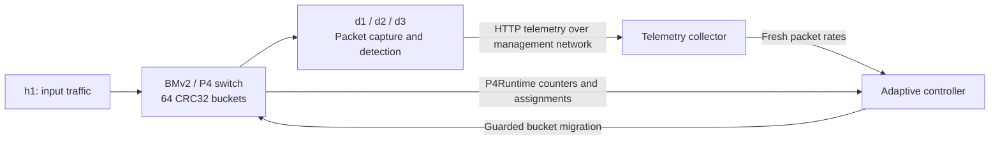

# Project Canopy

**Flow-affine packet distribution and adaptive detector load balancing with P4.**

Canopy(dynohash for this repositories purpose) is a network research prototype built with P4, BMv2, P4Runtime, Python,
and Mininet. It distributes IPv4 TCP/UDP traffic across three detector servers,
collects traffic statistics, and evaluates whether moving a traffic bucket would
improve the load distribution.

The switch hashes each IPv4 five-tuple into one of **64 buckets**. Packets in the
same flow use the same bucket. Changing a bucket's detector assignment redirects
subsequent packets through a verified P4Runtime table update.

## Current project status

Status reviewed **November 8, 2026**, using the implementation, project documentation,
and recorded test results. Automated verification and live VM verification are
reported separately.

| Checkpoint | What it adds | Current status |
| --- | --- | --- |
| 1 — P4 forwarding | CRC32 five-tuple hashing, 64 buckets, detector forwarding, Ethernet rewriting, counters | **PASSED live**, confirmed in the project baseline |
| 2 — Manual migration | Single-bucket migration with full-table readback and preservation of unrelated assignments | **PASSED live**; 23 controller tests pass |
| 3 — Detection and telemetry | Packet capture, rolling statistics, heuristic alerts, HTTP collector | **PASSED live**, confirmed in the project baseline; 26 tests pass |
| 4 — Adaptive controller | Sustained load evaluation, measured bucket selection, dry-run and explicitly enabled automatic migration | **Implemented**; 44 tests pass; live verification awaits review of a passing end-to-end report |
| 5 — Detector state transfer | Preserve detection history when a bucket moves | **Implemented, best-effort**; reviewed live normal scenario PASSED; failure-injection and live adaptive-loop scenarios not yet established |

The latest recorded automated run has **128 passing tests** (93 from Checkpoints 2-4
plus 35 from Checkpoint 5), **zero failures, and zero errors**. Syntax and whitespace
checks also passed. These are recorded results, not a claim that tests run
automatically whenever this README is opened.

Checkpoint 4's accessible validation summary records live execution as **BLOCKED /
LIVE NOT VERIFIED** in the restricted development environment. Additional local
live-report directories exist, but their contents were not readable during this
documentation review. A branch name or commit message alone does not establish a
live pass. See [Checkpoint 4](docs/checkpoint4.md) for evidence requirements.

Checkpoint 5's reviewed live normal scenario (bucket 57, `d1 -> d2 -> d1`, full
64-entry restoration, unchanged BMv2 PID, no cleanup errors) **PASSED**; see
[Checkpoint 5](docs/checkpoint5.md) and `docs/evidence/checkpoint5-live-b_mpsqxm.summary.json`.
Failure-injection and live adaptive-loop integration scenarios are not established
by that evidence. State transfer remains best-effort: not atomic, exactly-once, or
lossless.

## How it works



1. The switch hashes source IP, destination IP, source port, destination port, and
   IP protocol into a bucket.
2. The bucket's table entry selects a detector port and destination MAC address.
3. The detector captures incoming data traffic and maintains bounded packet, byte,
   flow, and source statistics.
4. Approximately once per second, the detector sends telemetry to the collector.
5. The adaptive controller compares fresh detector packet rates and measures bucket
   PPS from two switch-counter snapshots.
6. A sustained imbalance can produce a migration proposal. With explicit live
   opt-in, the existing migration transaction changes one entry and reads back all
   64 assignments to verify the result.

For example, moving a measured 300-PPS bucket from loads **900 / 300 / 100 PPS**
predicts **600 / 300 / 400 PPS**, reducing the maximum-to-minimum gap from 800 to
300 PPS. The controller requires a configurable minimum improvement before acting.

### Lab topology

| Host | Data IP | Management IP | BMv2 port |
| --- | --- | --- | --- |
| h1 | `10.0.0.1` | — | 1 |
| d1 | `10.0.0.11` | `172.18.50.11` | 2 |
| d2 | `10.0.0.12` | `172.18.50.12` | 3 |
| d3 | `10.0.0.13` | `172.18.50.13` | 4 |

- Detector data interfaces: `d1-eth0`, `d2-eth0`, `d3-eth0`.
- Detector management interfaces: `d1-mgmt0`, `d2-mgmt0`, `d3-mgmt0`.
- Root management bridge: `dh-mgmt-br`, `172.18.50.1/24`.
- Collector: `http://172.18.50.1:8080/api/v1/telemetry`.
- P4Runtime: `127.0.0.1:50051` in the VM's root namespace.

Detector localhost refers to the detector's own namespace. Use the management
bridge address when contacting the collector from a detector.

## Requirements

The existing development environment is an **Ubuntu 22.04 VM** with:

- Python 3.10 or newer and a project virtual environment.
- Mininet available to `/usr/bin/python3`.
- BMv2 `simple_switch_grpc` and the P4 toolchain.
- Existing P4Runtime Python dependencies: grpc, protobuf, P4Runtime, and
  `p4runtime-shell` for explicit fresh-switch provisioning.
- Linux networking tools and root privileges for Mininet/raw packet capture.
- `tcpdump` for the Checkpoint 2 live regression harness.

The repository includes compiled P4 JSON/P4Info artifacts. Recorded toolchain
versions are in [tools/](tools/). The detector and collector use Python's standard
library; packet capture does not require Scapy.

Reuse the existing `.venv` when it is already configured. For a fresh checkout
**after provisioning the VM's system tools**, create the Python environment:

```bash
cd ~/dynohash
python3 -m venv .venv
.venv/bin/python -m pip install -r tools/p4runtime-requirements.txt
```

The requirements file records the Python dependency environment. `make init`
(see below) additionally installs Mininet, BMv2, and the P4 compiler.

## Running the project

Commands below assume the repository is checked out at `~/dynohash` and that each
terminal starts in that directory. Commands labeled **Mininet CLI** are entered at
the `mininet>` prompt; ordinary shell commands run in a separate VM terminal.

### Quick start with `make`

Run `make init` once (creates `.venv`, installs the pinned Python dependencies, and
installs Mininet/BMv2/p4c for the detected Ubuntu release). Then each of the three
regular terminals below has a matching target:

| Terminal | Purpose | Command |
| --- | --- | --- |
| A | Topology | `make topology` |
| B | Collector | `make collector` |
| C | Adaptive controller (dry-run) | `make adaptive` |
| C | Adaptive controller (live) | `make adaptive-live` |

This covers steps 1, 3, and 5 below. The one-time empty-switch provisioning (step 2)
and starting detectors from the Mininet CLI (step 4) are still manual, since they run
inside an already-open terminal/CLI rather than as a standalone command.

### 1. Start the topology — regular terminal A

If a DynoHash topology is already running, reuse its Mininet terminal. Otherwise:

```bash
cd ~/dynohash
sudo /usr/bin/python3 tests/topology/dynohash_detectors.py
```

Leave terminal A open at `mininet>`. This command creates a new topology and BMv2
process. Do not run another copy against existing interfaces. Exiting that Mininet
CLI stops the topology and its switch.

### 2. Provision only a new, empty switch — regular terminal B

**Skip this step for an already configured switch.** The following command loads
the pipeline and inserts the initial 64 round-robin assignments. It must only be
used for a newly created, empty lab switch:

```bash
cd ~/dynohash
PYTHONPATH=. .venv/bin/python tools/initialize_checkpoint2.py --new-empty-switch
```

Verify the existing table with:

```bash
.venv/bin/python -m controller.cli verify
.venv/bin/python -m controller.cli list
```

Use one P4Runtime writer at a time. Close another P4Runtime shell/controller before
these commands or the adaptive harness; do not increase election IDs to take over.
Normal controller commands do not reload the pipeline.

### 3. Start the collector — regular terminal B

If a collector is already running on this endpoint, reuse it. Otherwise:

```bash
cd ~/dynohash
.venv/bin/python -m detectors.collector --bind 172.18.50.1 --port 8080
```

Keep this terminal open. The collector accepts `POST /api/v1/telemetry`; a `GET` to
the same path returns latest detector readings, staleness, and recent events.

### 4. Start detectors — existing Mininet CLI

Skip instances that are already running. These commands use Mininet's `px` command
to retain handles to the processes you start, while keeping the CLI available.
The topology has already created the `logs/` directory.

```text
px import subprocess
px detector_d1 = d1.popen(['.venv/bin/python', '-m', 'detectors.minimal_detector', '--server-id', 'd1', '--interface', 'd1-eth0'], stdout=open('logs/d1-detector.log', 'a'), stderr=subprocess.STDOUT)
px detector_d2 = d2.popen(['.venv/bin/python', '-m', 'detectors.minimal_detector', '--server-id', 'd2', '--interface', 'd2-eth0'], stdout=open('logs/d2-detector.log', 'a'), stderr=subprocess.STDOUT)
px detector_d3 = d3.popen(['.venv/bin/python', '-m', 'detectors.minimal_detector', '--server-id', 'd3', '--interface', 'd3-eth0'], stdout=open('logs/d3-detector.log', 'a'), stderr=subprocess.STDOUT)
```

Check management routes and process status:

```text
d1 ip route get 172.18.50.1
d2 ip route get 172.18.50.1
d3 ip route get 172.18.50.1
py (detector_d1.poll(), detector_d2.poll(), detector_d3.poll())
```

Routes should use the matching `dN-mgmt0` interface. A process `poll()` result of
`None` means it is still running. Detector logs are written to `logs/dN-detector.log`.
Allow at least three seconds for detector window warmup.

To inspect telemetry from a regular terminal:

```bash
.venv/bin/python - <<'PY'
import json
from urllib.request import ProxyHandler, build_opener

opener = build_opener(ProxyHandler({}))
with opener.open('http://172.18.50.1:8080/api/v1/telemetry', timeout=2) as response:
    print(json.dumps(json.load(response), indent=2))
PY
```

### 5. Run the adaptive controller — regular terminal C

Start with **dry-run**:

```bash
cd ~/dynohash
.venv/bin/python -m controller.adaptive_cli --iterations 60
```

Dry-run emits JSON decisions and performs no switch writes. With idle or balanced
traffic, an inhibited/balanced result is expected; a proposal requires sustained
imbalance and a beneficial active bucket.

To explicitly enable live automatic migration:

```bash
.venv/bin/python -m controller.adaptive_cli --iterations 60 --live --acknowledge-state-loss
```

**Live migration redirects subsequent packets and does not transfer detector
history.** Both flags are required. Default safeguards include a five-second
sustained imbalance, hysteresis, 60-second bucket cooldown, 10-second global
cooldown, telemetry settling, and a maximum of one migration per process.

The bounded loop exits after the requested iterations. Exit code 0 means the loop
completed; inspect its JSON statuses to determine whether a migration was proposed
or verified. Runtime/write/readback faults stop the controller with an error.

### Manual migration

With the adaptive controller and other P4Runtime writers stopped:

```bash
.venv/bin/python -m controller.cli show --bucket 59
```

The following is an explicit example that **changes live forwarding**:

```bash
.venv/bin/python -m controller.cli migrate --bucket 59 --to d1
.venv/bin/python -m controller.cli verify
```

Record the original owner before a manual change and restore that actual owner
after testing. Readback verifies the requested bucket and all unrelated assignments;
a successful write response alone is insufficient.

### Stop only the detector processes you started

If you used the `px` commands above, stop those handles in the same Mininet CLI:

```text
px detector_d1.terminate()
px detector_d2.terminate()
px detector_d3.terminate()
py (detector_d1.wait(timeout=5), detector_d2.wait(timeout=5), detector_d3.wait(timeout=5))
```

Stop your collector with Ctrl-C in its terminal. Keep Mininet/BMv2 running when
continuing switch tests; avoid global cleanup or terminating unrelated services.

## Tests

### Automated regression tests — regular terminal

These tests use fixtures/fake switches and temporary local HTTP servers. They do
not require a running Mininet topology or alter live switch state.

```bash
cd ~/dynohash
.venv/bin/python -m unittest discover -s tests/controller -v
.venv/bin/python -m unittest discover -s tests/detectors -v
.venv/bin/python -m unittest discover -s tests/adaptive -v
.venv/bin/python -m unittest discover -s tests/state -v
```

The Checkpoint 5 suite requires generated hash evidence (`tools/verify_checkpoint5_hash.py`)
and will error on two attribution tests without it; see [Checkpoint 5](docs/checkpoint5.md).

| Suite | Latest recorded passing count |
| --- | ---: |
| Checkpoint 2/controller | 23 |
| Checkpoint 3/detectors and HTTP | 26 |
| Checkpoint 4/adaptive | 44 |
| Checkpoint 5/state transfer | 35 |
| **Total** | **128** |

Syntax and whitespace checks:

```bash
.venv/bin/python -m compileall -q controller detectors tests/controller tests/detectors tests/adaptive tests/state tests/topology/checkpoint2_migration.py tests/topology/checkpoint3_detection.py tests/topology/checkpoint4_adaptive.py tests/topology/checkpoint4_worker.py tests/topology/checkpoint5_state.py tests/topology/checkpoint5_worker.py tools/initialize_checkpoint2.py tools/verify_checkpoint5_hash.py
git diff --check
```

### Live integration — existing Mininet CLI

Leave the programmed switch running, close P4Runtime writers, and isolate unrelated
data traffic. The Checkpoint 4 harness reuses identifiable running services, starts
missing test-owned services, and stops only its own children. Manually started
services remain your responsibility.

Dry-run end-to-end test:

```text
py __import__('runpy').run_path('tests/topology/checkpoint4_adaptive.py')['exercise'](net)
```

Explicit live test with one adaptive migration and guarded restoration:

```text
py __import__('runpy').run_path('tests/topology/checkpoint4_adaptive.py')['exercise'](net, live=True, acknowledge_state_loss=True)
```

The harness discovers actual bucket mappings through packet-counter deltas, checks
balanced and imbalanced traffic, verifies capture/telemetry, and compares ownership
and BMv2 PIDs. Live mode additionally verifies post-migration delivery and attempts
restoration in `finally`. Unrelated or unexpected ownership changes cause restoration
to fail safely and be reported rather than overwritten.

The parent `logs/checkpoint4-*/report.json` is the authoritative run result.
`PASSED` in dry-run mode does not establish live migration success. A live pass
requires all assertions, one verified migration, successful restoration, unchanged
BMv2 PID, and no cleanup errors. Abrupt process termination or loss of controller
ownership can prevent restoration; inspect the report before retrying.

Checkpoint 3 live capture/telemetry regression:

```text
py __import__('runpy').run_path('tests/topology/checkpoint3_detection.py')['exercise'](net)
```

Run that separate harness with no duplicate manually started Checkpoint 3 services;
it starts and cleans up its own services. See the checkpoint documents for details.

## Configuration and repository layout

| Path | Responsibility |
| --- | --- |
| [`p4/dynohash.p4`](p4/dynohash.p4) | Forwarding pipeline, hashing, rewriting, counters |
| [`config/dynohash.json`](config/dynohash.json) | Detector IDs, ports, MACs and management addresses |
| [`config/checkpoint3.json`](config/checkpoint3.json) | Detector window, threshold, cooldown and telemetry endpoint |
| [`config/checkpoint4.json`](config/checkpoint4.json) | Adaptive thresholds, freshness, cooldowns and migration limits |
| [`config/checkpoint5.json`](config/checkpoint5.json) | State-transfer feature settings, disabled by default |
| [`controller/`](controller/) | Manual migration, P4Runtime adapter, adaptive policy, state-transfer coordinator and CLIs |
| [`detectors/`](detectors/) | Capture, bounded statistics, telemetry sender/collector, opt-in state API |
| [`tests/`](tests/) | Unit/HTTP tests and existing-topology live harnesses |
| [`tools/`](tools/) | Explicit fresh-switch provisioning and environment records |
| [`docs/`](docs/) | Detailed checkpoint architecture, commands and evidence |

Detector defaults include a 1000-PPS alert threshold, a three-second minimum
observation window, 100 minimum packets, and a ten-second alert cooldown. Adaptive
load balancing is separate from the detector's suspicious-traffic flag.

## Limitations and next steps

- Detection is a packet-volume heuristic; an alert is not definitive proof of DDoS.
- The supported data path is unfragmented IPv4 TCP/UDP with a fixed 20-byte IP
  header. IPv6, VLAN-tagged frames and IPv4 options/fragments are outside this path.
- Per-detector CPU, queue and capture-drop measurements are unavailable and remain
  `null`. PPS measures traffic volume rather than computational cost.
- Detector state and collector history are bounded and in memory. Saturated identity
  tracking is flagged; flow/source counts can then be lower bounds.
- The default five-bin detector window spans four to less than five seconds after
  warmup. Reported rates use the actual reported duration.
- Exact Python/BMv2 CRC32 parity is unverified. Detector `per_bucket` is `null`;
  adaptive bucket estimates come from the switch's counters.
- State transfer (Checkpoint 5) is implemented but best-effort: not atomic,
  exactly-once, or lossless. Only the reviewed normal live scenario has passed;
  failure-injection and live adaptive-loop integration scenarios remain unverified.
- Adaptive decisions assume recent traffic predicts near-future demand. Cooldowns
  are process-local, and counter resets/invalid timing can inhibit decisions.
- HTTP telemetry and localhost gRPC are intended for an isolated lab. Authentication,
  durable coordination and production deployment hardening remain future work.

## Detailed documentation

- [Checkpoint 2 — Manual bucket migration](docs/checkpoint2.md)
- [Checkpoint 3 — Detection server and telemetry](docs/checkpoint3.md)
- [Checkpoint 4 — Adaptive load evaluation and migration](docs/checkpoint4.md)
- [Checkpoint 5 — Detector state transfer](docs/checkpoint5.md)
- [Repository conventions and verified progress](AGENTS.md)

Older checkpoint notes preserve historical blocked attempts. Use their later audit
sections, the current status above, and actual live reports when assessing progress.
Generated `logs/` reports are ignored by Git and may only exist on the testing VM.
