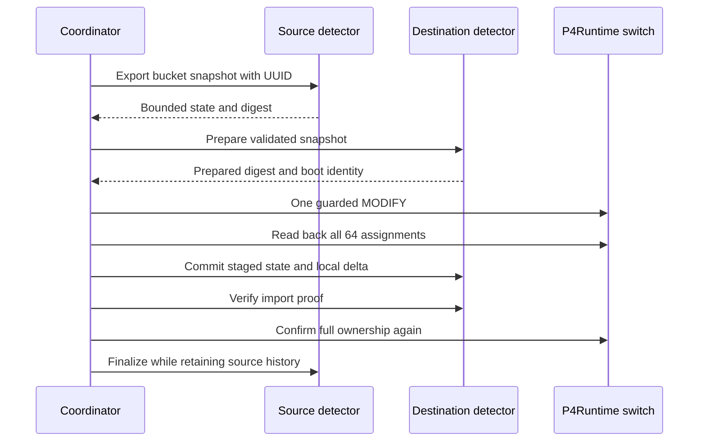

# Checkpoint 5: best-effort detector state transfer

Status: **PASSED for the reviewed normal live Mininet/BMv2 scenario**: bucket 57
migrated d1 -> d2 and was restored to d1, with state import and continuing packet
processing verified. The original 64 assignments were restored, BMv2 PID was unchanged,
and both reports contain no cleanup errors. See the reviewed evidence below.
Live failure-injection scenarios and live adaptive-loop integration are not established
by this run. The implementation remains best-effort, not atomic, exactly-once or lossless.

## Inspection, baseline and scope

Branch inspected: `feature/checkpoint5-state-transfer`. The only pre-existing change
was untracked `README.md`, which is preserved unchanged. AGENTS.md, Checkpoint 2/3/4
documents, actual controller/detector/config files, P4 source/compiled calculations,
and existing tests/harnesses were inspected before implementation. The user identifies
Checkpoints 1–4 as the verified baseline. Older documents preserve historical blocked
agent attempts; they are not overwritten.

Existing migration remains `BucketController.migrate`: one MODIFY, all 64 entries
read back, unrelated assignments unchanged. Existing adaptive sampling, election ID
(0,1), cooldowns and dry-run behavior are reused. There is no P4, compiled artifact,
packet-format or topology change. The initial implementation and this evidence review
did not install packages, reinitialize a configured pipeline, restart BMv2 or clean up
the topology. This review inspected an existing completed run; it did not rerun it.

## Attribution prerequisite: verified method without a P4 change

The exact P4 hash tuple is IPv4 src (32), IPv4 dst (32), transport src (16), transport
dst (16), IP protocol (8), in that order. Both TCP and UDP use `crc32`, base 0,
maximum 64. The compiled JSON assigns those fields into scalar temporaries and hashes
them in the same order. Fields are byte-aligned: the serialized key is 13 bytes,
network byte order, equivalent to `struct.pack('!IIHHB', ...)`. Detector parsing
supports well-formed unfragmented IPv4 TCP/UDP with IHL=5 and the switch-rewritten MACs.

Before adding bucket state, an offline C++ oracle was compiled against the **already
installed BMv2 library**, not an independent CRC implementation. It constructs BMv2
PHV fields, serializes them with `BufBuilder`, and uses its registered `crc32`.
**10,107 vectors** matched Python's serialized keys and full 32-bit `zlib.crc32`
results: zero/all-ones/recorded flow, all 104 input-bit basis vectors, and 10,000
seeded TCP/UDP vectors. All 64 bucket outcomes were covered. The recorded CP2
`10.0.0.1:40009 -> 10.0.1.100:9000 UDP` also gives bucket 59.

This is build/layout-specific evidence, not an assertion about arbitrary targets.
`tools/verify_checkpoint5_hash.py` reproduces it and fingerprints P4 source/JSON,
mapper/oracle code, the installed switch executable and BMv2 library. Agents refuse
state-enabled startup if those fingerprints differ or evidence is missing. The
controller additionally uses a **read-only GetForwardingPipelineConfig(ALL)** and
requires the live device JSON to match the parity-verified JSON (ignoring JSON
whitespace/key ordering). It repeats that check during transfer. If the server cannot
return that JSON, transfer fails closed; do not bypass the guard or reload the switch.
The live harness also checks the running executable fingerprint and actual packet
counter deltas for its test tuple before transferring anything.

No bucket is inferred from detector ID/port. No per-bucket data is enabled from the
single bucket-59 example alone. Normal telemetry keeps `per_bucket=null` for backward
compatibility; the opt-in state API supplies verified bucket history separately.

## Files

| Added/modified file | Responsibility |
| --- | --- |
| `detectors/bucket_hash.py` | Fixed tuple encoding, bucket mapping, layout/evidence validation |
| `tests/state/bmv2_crc_oracle.cpp` | Uses installed BMv2 field serializer and CRC implementation |
| `tools/verify_checkpoint5_hash.py` | Offline oracle comparison and fingerprint report; exclusive output creation |
| `detectors/bucket_state.py` | Bounded bucket statistics, strict serialization/validation, staging, commit, abort |
| `detectors/state_api.py` | Management-only HTTP API and peer allowlist |
| `detectors/minimal_detector.py` | Optional state tracking/API alongside existing capture and unchanged telemetry |
| `controller/state_transfer.py` | HTTP client, journaled coordinator, actual-owner reconciliation, state proof |
| `controller/state_cli.py` | Journal inspection and explicit management-only reconciliation/abort |
| `controller/adaptive.py` | Optional migrator injection; original transaction remains the default |
| `controller/adaptive_cli.py` | Optional state config; enabled live runs construct the coordinator |
| `config/checkpoint5.json` | Disabled-by-default feature settings |
| `tests/state/test_state_transfer.py` | Unit, fake-P4, real localhost HTTP, timeout and recovery tests |
| `tests/topology/checkpoint5_state.py` | Existing-Mininet live assertions and failure scenarios |
| `tests/topology/checkpoint5_worker.py` | One venv P4Runtime owner, coordination, reverse transfer/restoration |
| `AGENTS.md` | Concise progress and remaining live work |

The existing `Statistics` implementation is reused for each opt-in bucket, including
its heuristic/cooldown algorithm. Global detector statistics/telemetry continue to
count locally captured packets only; imported history never inflates global lifetime
packet counters or old telemetry fields.

## State schema and bounds

Snapshot schema version 1 has exactly:

- `version`, canonical UUID `transfer_id`, integer `bucket_id` (0..63).
- `source`, `destination` (configured d1/d2/d3, distinct), source process `source_boot_id`.
- Unix UTC `created_at`, `first_seen`, `last_seen`; matching `attribution_id`.
- Matching `statistics_config` for window, threshold, minimum requirements, cooldown
  and identity bounds; incompatible source/destination heuristics are rejected.
- `state`: lifetime `packets_total`/`bytes_total`, portable `started_age_seconds`,
  nullable `last_alert_age_seconds`, `alert_count`, latest <=32 alerts, rolling `bins`.
- Each bin contains relative `age_seconds`, packet/byte counts, capped JSON-five-tuple
  string -> packet counters, IPv4 source -> packet counters, and a `limited` flag.

Window-bin timestamps provide per-flow timing at one-second granularity. There are
no raw packets, TCP sequence/reassembly state, or invented historical counters.
Validate schema/types, finite nonnegative bounded numbers, identities, snapshot age,
flow-to-bucket hashes, source/flow count consistency and window/lifetime sums.
Snapshot digests use canonical JSON SHA-256, binding a prepared/committed result to
one immutable exported payload. Counts and proof refer to that payload, not to a
promise of lossless packet delivery.

Defaults in `config/checkpoint5.json`:

| Setting | Default | Meaning |
| --- | --- | --- |
| enabled | false | Preserve Checkpoint 4 behavior until explicitly enabled |
| port | 8091 | Separate detector state API on each configured management IP |
| http_timeout_seconds | 0.5 | Client socket timeout, at most 2 seconds |
| max_snapshot_age_seconds | 30 | Maximum age for first destination preparation |
| max_body_bytes | 131072 | Incoming JSON body limit, including wrapper |
| max_records | 128 | Agent transaction records and coordinator journal capacity |
| record_retention_seconds | 120 | Terminal retry records retained at least this long |
| max_flows_per_bin | 128 | Flow/source identity caps for bucket-local statistics |
| journal_directory | logs/checkpoint5-transfers | UUID-named transaction journals |
| attribution_evidence | logs/checkpoint5-hash.json | Required matching oracle/fingerprint evidence |

At most 64 bucket records exist. State mode supports <=10 one-second bins per bucket;
the existing detector default is 5. Identity saturation retains observed global/bucket
packet totals while marking incomplete flow/source histories. Oversized exports fail
before P4 changes. Active exported/prepared records are **not automatically evicted**:
capacity exhaustion rejects new transfers instead of discarding uncertain state.
Terminal records can expire after retention. Retry proofs are bounded, not forever;
late requests can return unknown and require operator inspection. UUIDs must not be
reused for a different operation. Journals are bounded by refusing new files at the
configured capacity, and existing evidence is not automatically deleted.

Portable ages are reconstructed using local monotonic time plus transfer age.
Age at preparation is preserved across wall-clock rollback. Rolling bins align to
local seconds, introducing up to one second of quantization; expired bins are dropped.
Alerts/cooldown are restored, with merged alert IDs renumbered for the destination's
bucket sequence. The initial negative-infinity cooldown sentinel becomes JSON null.

## Management API and trust boundary

Production agents bind only to their configured `management_ip:8091`. Wildcard
binding is refused. Requests are allowed only from the configured management bridge
IP and detector management IPs. Localhost is permitted only when a test explicitly
creates a localhost fixture with that allowlist. Peer denial returns 403.

This uses the **trusted isolated lab management network**, not cryptographic user
authentication. Any process able to use an allowlisted management address is trusted.
There is no TLS, bearer-token authentication or hostile-peer defense. The digest
binds content; it is not an authentication signature. Do not expose this API publicly.

GET:
- `/api/v1/state/health`: detector identity, boot UUID, attribution evidence ID.
- `/api/v1/state/buckets/59`: bucket counters and portable rolling state (read-only).

POST `/api/v1/state/{operation}` requires JSON, one Content-Length and no chunking.
Every body contains `server_id` (receiver), `bucket_id`, and `transfer_id`. Operations:

| Operation | Extra fields | Effect |
| --- | --- | --- |
| export | destination | Cache immutable source snapshot; lock that bucket |
| prepare | snapshot | Validate and stage; track new destination arrivals separately |
| status | none | Return stage, digest, proof, boot identity and current bucket counts |
| commit | owner, ownership_digest | Activate prepared history plus post-prepare local delta |
| finalize | owner, destination_digest | Record verified destination completion; retain source history |
| abort | none | Discard only uncommitted staging/release own lock; preserve source history |

Success is HTTP 200. Invalid data returns 400, unknown transaction/endpoint 404,
conflict/capacity refusal 409, and oversized bodies 413. Duplicate JSON keys are
rejected. There is no pickle/eval/arbitrary object deserialization. Ownership digests
are controller attestations; agents do not independently connect to P4Runtime.

Identical prepare/commit requests are idempotent while their record exists. Conflicting
UUID reuse is rejected. An old abort/finalize request cannot release a newer bucket
lock. Committed history cannot be aborted. Old pre-existing destination history is
superseded on commit rather than added again; only observations made **after prepare**
are merged with the source snapshot, preventing that particular double-count source.

## Transfer protocol and failure policy



1. Verify original full-table ownership and live hash layout; allocate/journal UUID.
2. Check both agent identities/evidence, export the source bucket snapshot and digest.
3. Prepare destination state; verify staged digest and destination boot identity.
4. Revalidate the original table and adaptive freshness/benefit guard; journal the
   write intent and check the guard again immediately before sending.
5. Execute one existing P4Runtime MODIFY, then full-table readback. Track one MODIFY
   call/intent per transfer ID; never blindly resend after a lost response.
6. Re-read actual destination ownership, commit prepared state, and verify committed
   digest, imported packet/byte/flow-bin counts and retained bucket totals.
7. Re-read all ownership again and finalize the source. **Source bucket history is
   retained**, even after completion. Record counts, timings, proof and outcome.

The adaptive controller still needs `--live --acknowledge-state-loss` because this
handoff remains imperfect. With `enabled=false`, the original Checkpoint 4 path is
used. With dry-run, no state API requests or state/journal mutations are performed,
even if the state feature's config is enabled. State-transfer errors stop the live
adaptive loop for inspection rather than starting repeated migrations.

| Failure | Action |
| --- | --- |
| Validation/export/preparation fails before P4 | Confirm full table still original, abort only this UUID's staging/export lock; retain source history |
| Freshness/benefit expires before sending | No P4 send; abort staging only after confirmed original ownership |
| P4 call fails and actual table is original | Record failure/abort; do not resend that ID |
| Write response lost but actual table is intended destination | Preserve prepared state and source; mark uncertain; explicit reconciliation can finish without another MODIFY |
| Commit/finalize response lost | Status/digest/boot proof allows idempotent reconciliation; no duplicate import |
| Unexpected owner/unrelated entry/failed ownership read | Mark uncertain, retain both sides, refuse automatic rollback/deletion |
| Agent reboot or missing proof | Fail closed; source history is retained if that process survived; in-memory history is not reboot-durable |

The journal uses atomic file replacement, not a distributed transaction or guaranteed
power-loss durability. Operation timings are accumulated by agent/operation and a
bounded list records errors. `p4_modify_calls` is a conservative call/intent count:
a failed request may not have reached BMv2. Only completed ownership/state readbacks
justify success. Journals include the full bounded exported snapshot for diagnosis.

### Inspection and explicit recovery

Stop other P4Runtime writers first. Use the same state config/journal directory and
transfer UUID printed in the migration event. If the journal was created by the
root live harness, run these from that root Mininet CLI using `sh` or an appropriately
privileged terminal; permissions are not automatically changed.

```bash
.venv/bin/python -m controller.state_cli status --state-config /tmp/dynohash-checkpoint5-lab.json --transfer-id UUID
.venv/bin/python -m controller.state_cli reconcile --state-config /tmp/dynohash-checkpoint5-lab.json --transfer-id UUID --allow-state-mutations
.venv/bin/python -m controller.state_cli abort --state-config /tmp/dynohash-checkpoint5-lab.json --transfer-id UUID --allow-state-mutations
```

`status` only reads the local journal. `reconcile` refuses unless actual ownership
already matches the intended destination; it issues no fresh MODIFY and only finishes
state verification/finalization. `abort` requires the **entire original table** still
be present and refuses to delete committed history. Neither command blindly moves a
bucket back. Use a new UUID after a terminal pre-write abort; do not reuse the old ID.
If agents have rebooted or their retry proof expired, inspect reports before retrying.

## Exact manual VM setup and live validation

Use the **existing** topology/BMv2 session. Do not initialize, reload, restart, run
`mn -c`, or start a second topology. Resolve duplicate controllers before testing.
Run commands from `~/dynohash`; Mininet Python examples assume that working directory.

### Fresh-switch provisioning only (skip for an existing configured switch)

These are reproduction instructions, not actions performed during this evidence
review. If no topology is running, start the disposable lab topology in terminal A:

```bash
cd ~/dynohash
sudo /usr/bin/python3 tests/topology/dynohash_detectors.py
```

Leave its Mininet CLI open. Only for that **NEW, empty switch**, provision in terminal B:

```bash
cd ~/dynohash
PYTHONPATH=. .venv/bin/python tools/initialize_checkpoint2.py --new-empty-switch
.venv/bin/python -m controller.cli verify
```

`PYTHONPATH=.` makes repository modules available to the provisioning script.
Initialization loads the pipeline and inserts the 64 initial entries. Never rerun
it against the existing configured switch or as part of migration/restoration.
If the switch is already configured, skip this entire subsection and reuse it.

### 1. Generate build-specific evidence without touching the switch

The installed BMv2 headers/library, g++ and GMP development support were already
available here. No dependencies were installed. If unavailable on another VM, the
oracle step is blocked until the toolchain is provided; do not substitute guessed CRC.
Choose a fresh output filename: the tool deliberately refuses to overwrite evidence.

```bash
cd ~/dynohash
.venv/bin/python tools/verify_checkpoint5_hash.py --output logs/checkpoint5-hash-vm.json
```

Create a separate enabled lab config, preserving the default disabled file:

```bash
.venv/bin/python - <<'PY'
import json
from pathlib import Path
settings = json.loads(Path('config/checkpoint5.json').read_text())
settings['enabled'] = True
settings['attribution_evidence'] = 'logs/checkpoint5-hash-vm.json'
with open('/tmp/dynohash-checkpoint5-lab.json', 'x') as output:
    json.dump(settings, output, indent=2)
PY
```

If that config/output already exists, verify and reuse it or choose another fresh
filename; do not overwrite previous test evidence. The implementation run's original
proof is `logs/checkpoint5-hash.json`, which can also be verified/reused unchanged.

### 2. Run state-enabled detectors in their existing namespaces

Keep/reuse the existing collector. Stop only old detector processes you own, using
their saved handles/terminals; coordinate with their owner if they are not yours.
The harness refuses missing state APIs and does not kill/restart existing services.

In the existing Mininet CLI (after stopping any duplicate instances):

```text
px import subprocess
px cp5_d1 = d1.popen(['.venv/bin/python', '-m', 'detectors.minimal_detector', '--server-id', 'd1', '--interface', 'd1-eth0', '--state-config', '/tmp/dynohash-checkpoint5-lab.json'], stdout=open('logs/cp5-d1.log', 'a'), stderr=subprocess.STDOUT)
px cp5_d2 = d2.popen(['.venv/bin/python', '-m', 'detectors.minimal_detector', '--server-id', 'd2', '--interface', 'd2-eth0', '--state-config', '/tmp/dynohash-checkpoint5-lab.json'], stdout=open('logs/cp5-d2.log', 'a'), stderr=subprocess.STDOUT)
px cp5_d3 = d3.popen(['.venv/bin/python', '-m', 'detectors.minimal_detector', '--server-id', 'd3', '--interface', 'd3-eth0', '--state-config', '/tmp/dynohash-checkpoint5-lab.json'], stdout=open('logs/cp5-d3.log', 'a'), stderr=subprocess.STDOUT)
py (cp5_d1.poll(), cp5_d2.poll(), cp5_d3.poll())
```

All polls should be None. State APIs bind to 172.18.50.11/.12/.13:8091, never a
wildcard or data interface. All three agents must use enabled state config, matching
build-specific attribution evidence and compatible statistics/heuristic settings.
The management bridge/routes must be present, the original 64 assignments valid,
and other P4Runtime writers closed. If the collector needs startup, use the existing command:

```bash
.venv/bin/python -m detectors.collector --bind 172.18.50.1 --port 8080
```

### 3. Run live state transfer and restoration

In the existing root Mininet CLI, with unrelated data traffic stopped:

```text
py __import__('runpy').run_path('tests/topology/checkpoint5_state.py')['exercise'](net, state_config='/tmp/dynohash-checkpoint5-lab.json', allow_live=True)
```

The harness reuses the bounded CP4 raw UDP fixture: 10.0.0.1:40009 ->
10.0.1.100:9002, protocol 17. It verifies actual counter attribution, source per-flow
state, export/import/P4 readback, continuing packets/state at destination, unchanged
unrelated assignments and PID, and finally restoration. It prefers a **reverse state
transfer** to restore ownership/history. If that fails, it attempts only the guarded
known table delta and reports state recovery as a cleanup failure (not PASSED).
Reverse restoration is a separate transaction with a separate UUID/MODIFY.

Explicit failure scenarios, run one at a time:

```text
py __import__('runpy').run_path('tests/topology/checkpoint5_state.py')['exercise'](net, state_config='/tmp/dynohash-checkpoint5-lab.json', allow_live=True, failure='unavailable_destination')
py __import__('runpy').run_path('tests/topology/checkpoint5_state.py')['exercise'](net, state_config='/tmp/dynohash-checkpoint5-lab.json', allow_live=True, failure='invalid_payload')
py __import__('runpy').run_path('tests/topology/checkpoint5_state.py')['exercise'](net, state_config='/tmp/dynohash-checkpoint5-lab.json', allow_live=True, failure='duplicate_request')
py __import__('runpy').run_path('tests/topology/checkpoint5_state.py')['exercise'](net, state_config='/tmp/dynohash-checkpoint5-lab.json', allow_live=True, failure='timeout')
py __import__('runpy').run_path('tests/topology/checkpoint5_state.py')['exercise'](net, state_config='/tmp/dynohash-checkpoint5-lab.json', allow_live=True, failure='p4_failure')
```

Fault injection is in the test worker only: unavailable prepare transport, invalid
schema, duplicated real prepare, lost response after a real commit, or failure before
sending MODIFY. It does not stop services or corrupt/reload a real pipeline. These
are injected scenarios, not claims that the network/server naturally failed.

Reports go to unique `logs/checkpoint5-live-*/report.json`, `worker-report.json` and
UUID journals. The **parent** report is authoritative. A failure-injection PASSED
means its specific safety assertions passed, not that normal migration was tested.
The normal scenario has now passed and its reports were reviewed below. The five
live failure-injection scenarios remain unverified by the supplied evidence; unit
and localhost failure tests do not establish those live outcomes.

### 4. Use adaptive integration (separate from the harness)

With the same detector services/config, first dry-run:

```bash
.venv/bin/python -m controller.adaptive_cli --iterations 60 --state-config /tmp/dynohash-checkpoint5-lab.json
```

Then explicit live opt-in, accepting best-effort continuity:

```bash
.venv/bin/python -m controller.adaptive_cli --iterations 60 --live --acknowledge-state-loss --state-config /tmp/dynohash-checkpoint5-lab.json
```

Do not run this writer concurrently with the live harness. With the default disabled
config, the original Checkpoint 4 invocation remains unchanged. Stop only cp5_d1/d2/d3
processes you started when finished; keep the topology/switch running as needed.

## Automated checks and evidence

The existing proof file is needed for the oracle-evidence unit test; generate it on
a fresh checkout before running the new suite. This repository ignores logs/ in Git.

```bash
.venv/bin/python tools/verify_checkpoint5_hash.py --output logs/checkpoint5-hash.json
.venv/bin/python -m unittest discover -s tests/state -v
.venv/bin/python -m unittest discover -s tests/controller -v
.venv/bin/python -m unittest discover -s tests/detectors -v
.venv/bin/python -m unittest discover -s tests/adaptive -v
.venv/bin/python -m compileall -q controller detectors tests tools
git diff --check
```

Do not rerun the first command onto existing evidence; verify it with
`verify_evidence('logs/checkpoint5-hash.json')` or choose a fresh filename as above.

Actual results in this implementation run:

| Check | Result |
| --- | --- |
| Installed BMv2 oracle parity | PASSED: 10,107 keys and full CRC32 values, all 64 buckets |
| Checkpoint 5 unit/localhost HTTP tests | 35 passed; 0 failures/errors |
| Existing Checkpoint 2/controller | 23 passed; 0 failures/errors |
| Existing Checkpoint 3 | 26 passed; 0 failures/errors |
| Existing Checkpoint 4 | 44 passed; 0 failures/errors |
| Total automated tests | 128 passed |
| Syntax and whitespace | PASSED |
| Checkpoint 5 normal Mininet migration/restoration | PASSED; reviewed report pair `checkpoint5-live-b_mpsqxm` |
| Live failure-injection scenarios / adaptive-loop state-transfer run | Not verified by the supplied reports |

HTTP fixtures use real temporary localhost servers and a fake switch; tests verify
invalid payload/peer/identity/size rejection, same-ID retries, bounded state, expiry,
clock rollback, failed P4 update, post-apply response loss, real HTTP commit timeout,
restart detection, safe abort, reverse transfer and dry-run zero state mutations.
Local socket tests ran outside the restricted sandbox with approval. The implementation
agent did not generate privileged live traffic, modify P4 state, create a topology or
replace services. The operator subsequently completed the live run reviewed below.
Checkpoint 1 has no separate unit suite in this checkout; relevant forwarding/parser
regressions are covered above, and this live run verifies forwarding for its test tuple.

Machine-readable evidence and raw test output are saved separately under
`logs/checkpoint5-*`; the final summary is `logs/checkpoint5-validation-final.json`
and final new-suite output is `logs/checkpoint5-state-tests-final.txt`. Earlier
evidence files are preserved. A read-only external environment check found the bridge UP at
172.18.50.1/24 and BMv2 PID 20807, but returned BLOCKED (exit 2): uid 1000 needs the
existing root Mininet CLI. That is historical implementation-environment evidence,
superseded for the normal scenario by the reviewed live results below; it does not
invalidate the later operator-run test.

### Reviewed live Mininet/BMv2 evidence

The operator supplied readable copies of these original reports for review:

- `logs/checkpoint5-live-b_mpsqxm/report.json` — authoritative parent result.
- `logs/checkpoint5-live-b_mpsqxm/worker-report.json` — protocol and restoration result.

Both parse as JSON and report **PASSED**. The parent's embedded restoration record
matches the separate worker report. The forward event began at
**2026-11-09T03:09:17.444901Z** (November 8 in America/New_York). A compact,
derived [evidence summary](evidence/checkpoint5-live-b_mpsqxm.summary.json) records
the reviewed file hashes and checked assertions. Original reports and earlier test
evidence were preserved; ignored bulk logs are not included in the commit.

| Assertion | Reviewed result |
| --- | --- |
| Scenario | Normal live test; `failure_injection=null` |
| Flow | UDP `10.0.0.1:40009 -> 10.0.1.100:9002`, protocol 17 |
| Actual bucket attribution | Bucket 57 increased by 20; all other bucket deltas were zero in the initial burst |
| Original owner / target | d1 -> d2 |
| Initial source bucket state | 20 packets, 1480 bytes; the test flow appears in rolling state |
| Destination import | Committed, matching snapshot digest and proof of 20 packets / 1480 bytes |
| Forward transaction | Complete; one MODIFY call, ownership=true and state=true |
| Continuing traffic | 20 additional packets; destination state reached 40 packets / 2960 bytes |
| Restoration | Reverse state transaction d2 -> d1 completed with ownership/state verification |
| Restored source state | d1 retained 40 packets / 2960 bytes after reverse transfer |
| Assignment restoration | All original 64 assignments restored exactly; bucket 57 returned to d1 |
| Switch uptime evidence | PID 33226 before and after |
| Cleanup | Empty parent, worker and transaction cleanup-error lists |

Forward transfer UUID: `4a437c5a-fd44-4a67-9f0e-31406312b1e3`.
Reverse/restoration UUID: `5482a87d-225a-4700-881a-77da4c044219`.
The forward and reverse transactions each made one MODIFY; restoration is a separate
transaction, not a second attempt at the forward write. Observed sample tables were
either the original table or that table with only bucket 57 assigned to d2.

This pass establishes the tested flow's attribution, bounded-state handoff,
continuing capture at d2, guarded reverse transfer and full ownership restoration.
It does **not** establish lossless transitions, exactly-once counts, atomicity,
nonempty alert-history continuity (this run's alerts were empty), reboot recovery,
hostile-peer security, sustained-load performance, or live automatic candidate
selection through the adaptive loop. Failure-injection live commands remain
reproduction options, not recorded passes for this report pair.

## Consistency limitations

- This is **best-effort**, not atomic migration or exactly-once accounting.
- Source packets observed between export and P4 cutover are not in the exported
  snapshot. Source retains them, but destination can miss that transition history.
- Destination keeps post-prepare arrivals; old destination history is superseded.
  This avoids adding that old baseline twice, but cannot deduplicate arbitrary earlier
  histories or distinguish late/in-flight duplicates across a handoff.
- Global CP3 telemetry/detector alert history is not imported. The new bucket-local
  instance reuses the same heuristic; only its state transfers. No claim of complete
  global alert-history continuity is made.
- Bin timing has one-second granularity. Large flow counts may be limited and very
  old rolling data expires naturally while transferring; lifetime counts remain.
- Source/destination state and retry caches are memory-only. Coordinator JSON files
  aid recovery but cannot restore history lost in a detector reboot or prove packets
  were delivered exactly once. Retention/capacity limits can require operator action.
- Capture loss, CPU cost and queue occupancy remain unmeasured. There is no traffic
  quiescence, packet buffering, persistent lease service or distributed lock.
- P4Runtime mastership, local coordinator locks, agent bucket locks and full-table
  guards reduce conflicts but cannot protect against out-of-protocol external writers.
- Abrupt worker/root process death or an in-flight timed-out write can prevent or
  delay restoration. Inspect actual ownership/state; never delete source history or
  blindly replay a MODIFY to make a report look successful.
